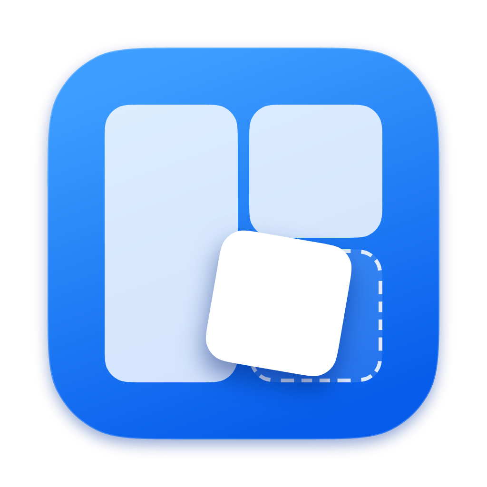
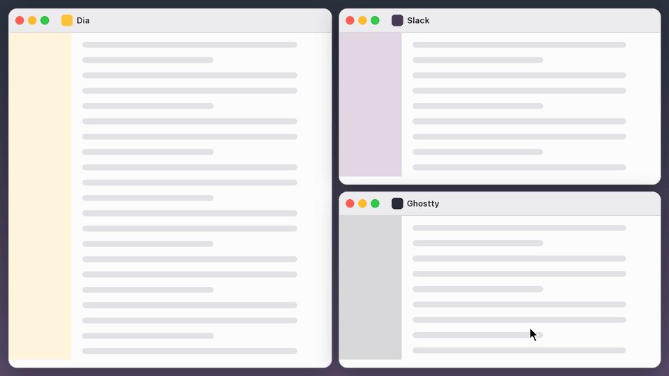
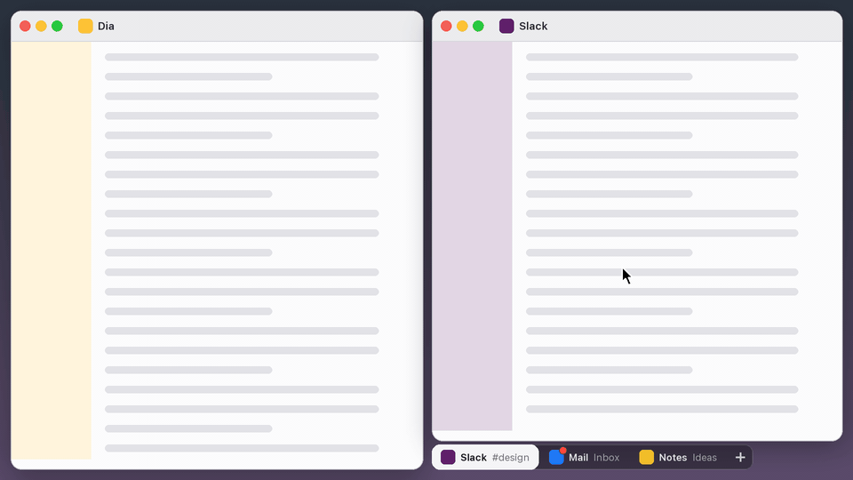
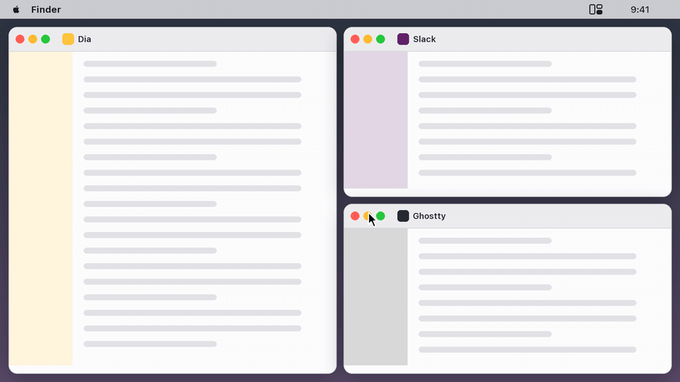
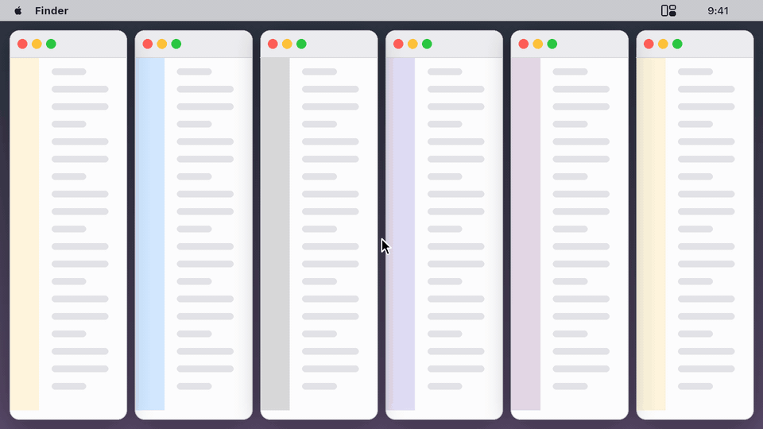
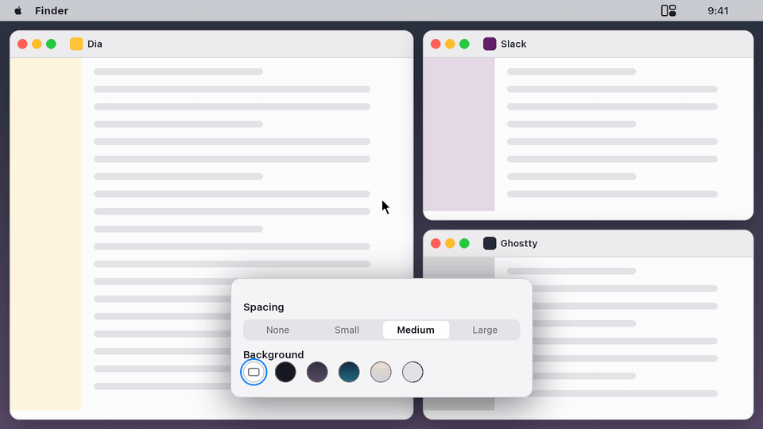

<p align="center">
  
</p>

<h1 align="center">nanopress</h1>

<p align="center">A tiling window manager for macOS that you use with the mouse.</p>

nanopress keeps your windows side by side, so none of them hides another. You arrange them by dragging: windows onto each other, tabs out of stacks, tiles around a minimap in the menu bar. It's a fork of [AeroSpace](https://github.com/nikitabobko/AeroSpace), and AeroSpace's keyboard shortcuts, commands and config file all still work.

## Drag a window where you want it

<p align="center">
  
</p>

Drag a window by its title bar over another window. The part under the cursor turns blue and says where yours goes:

| Drop on | What happens |
| --- | --- |
| A side | That window splits, and yours goes on that side |
| Stack, in the middle | The two windows share one spot, with tabs |
| Swap, in the middle | The two windows trade places |

While you hold the mouse, Tab switches between splitting the window, its column or the whole screen, and Esc puts the window back.

## Keep more windows in one spot

<p align="center">
  
</p>

Windows that share a spot get a strip of tabs, with the one in front highlighted. Click a tab or scroll over the strip to switch windows, and drag a tab away to give its window its own spot. "+" brings in any other window, from another workspace or minimized. A dot on a tab means the app has unread items.

## Arrange everything from the menu bar

<p align="center">
  
</p>

Click the nanopress icon in the menu bar for a minimap of your screen. Drag tiles to move windows, drag the gaps between them to resize, and drop a tile on a workspace number to send the window there. Your windows show each change at full size before you let go.

## Let nanopress tidy up

<p align="center">
  
</p>

Too many windows for the screen? Auto-arrange, below the minimap, suggests a few roomy layouts, with windows of a kind, like browsers or terminals, stacked together. Hover one to try it on your real windows, and click to keep it. It's also where nanopress starts when there's no layout saved yet.

## Make it look the way you like

<p align="center">
  
</p>

In Settings, pick how much space goes between your windows, from none to large, or let it grow with the screen. Behind them, keep your wallpaper or pick a calm color, so the gaps read as gaps.

## And also

- Resize a window over its neighbour to stack them; shrink a stacked window from a free edge to take it out.
- Double-click a title bar to give a window the whole screen, and again to bring your layout back.
- New windows open where you last put that app, and stack once the screen is full.
- Changes nanopress makes on its own come with Undo.
- Each display setup keeps its own layout.
- Apps you don't want tiled, like Finder, can float. See Settings.
- AI agents that speak MCP can arrange your windows too, if you turn it on in Settings. I'm still working out what for.

## Install

```sh
brew install --cask emrecaglarid/tap/nanopress
```

Open nanopress from Applications and give it Accessibility access when macOS asks. It needs that to move windows.

You can also download it from [Releases](https://github.com/emrecaglarid/nanopress/releases). nanopress isn't notarized by Apple yet, so a downloaded copy needs one extra step: open it once, then go to System Settings ▸ Privacy & Security and click Open Anyway.

## Keyboard and config

The config file is `~/.nanopress.toml` or `~/.config/nanopress/nanopress.toml`. Without one, nanopress reads your AeroSpace config. [AeroSpace's guide](https://nikitabobko.github.io/AeroSpace/guide) explains workspaces, key bindings and commands; use `nanopress` where it says `aerospace`.

## Building

With macOS and Swift 6:

```sh
swift build
.build/debug/NanopressApp
```

## Credits

nanopress is made by Emre Caglar, on [AeroSpace](https://github.com/nikitabobko/AeroSpace) by Nikita Bobko. You can [sponsor AeroSpace](https://github.com/sponsors/nikitabobko).

MIT licensed. See [LICENSE.txt](./LICENSE.txt) and [legal/](./legal).
