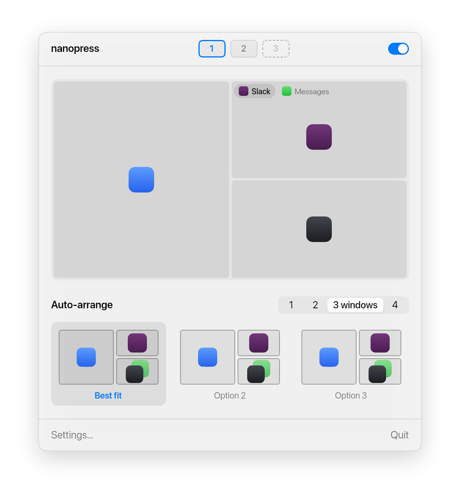

<p align="center">
  
</p>

<h1 align="center">nanopress</h1>

<p align="center">A tiling window manager for macOS that you use with the mouse.</p>

<p align="center">
  
</p>

nanopress keeps your windows side by side, so none of them hides another. To move a window, drag it by its title bar: a preview shows where it lands and which windows make room before you let go.

It's a fork of [AeroSpace](https://github.com/nikitabobko/AeroSpace). AeroSpace's keyboard shortcuts, commands and config file all still work.

## Install

```sh
brew install --cask emrecaglarid/tap/nanopress
```

Open nanopress from Applications and give it Accessibility access when macOS asks. It needs that to move windows.

You can also download it from [Releases](https://github.com/emrecaglarid/nanopress/releases). nanopress isn't notarized by Apple yet, so a downloaded copy needs one extra step: open it once, then go to System Settings ▸ Privacy & Security and click Open Anyway.

## Moving windows

Drag a window by its title bar and drop it on another window:

| Where you drop | What happens |
| --- | --- |
| Near an edge | Splits that window, yours goes on that side |
| In the middle | Stacks the two windows in one spot |
| In the middle, holding ⌥ | Swaps them |
| Against the screen edge | Puts yours along that whole side |

When there's more than one way to split, press Tab while still holding the mouse to switch between splitting the window, its column, or the whole screen.

## Stacks

<p align="center">
  
</p>

Windows that share a spot get a row of tabs. Click a tab to bring its window forward, scroll over the tabs to flip through them, or drag a tab away to give that window its own spot. "+" lists your other windows, minimized ones too, to bring one into the stack. A dot on a tab means the app has unread items.

## The menu bar panel

<p align="center">
  
</p>

Click the nanopress icon in the menu bar for a map of your screen. Drag the tiles to rearrange windows, drag the gaps between them to resize, and drop a window on a workspace number to move it there. Auto-arrange suggests layouts for the number of windows you want to see.

## Other things nanopress does

- Resizing a window over its neighbour stacks the two. Shrinking a stacked window from a free edge takes it out of the stack.
- Double-clicking a title bar gives that window the whole screen. Double-clicking again brings your layout back.
- A new window opens where you last put a window of that app. Once the screen is full, new windows are stacked instead of making everything smaller.
- When nanopress changes your layout on its own, a note with Undo appears. The menu bar panel keeps the last one too.
- Each display setup, like the laptop alone or the laptop with a monitor, has its own layout.
- Apps you don't want tiled stay floating. Finder floats by default. Set this and the background in Settings.
- With Agents turned on in Settings, an AI agent that supports MCP, like Claude, can arrange your windows when you ask. Window titles are only shared if you allow it.

## Keyboard and config

The config file is `~/.nanopress.toml` or `~/.config/nanopress/nanopress.toml`. Without one, nanopress reads your AeroSpace config. [AeroSpace's guide](https://nikitabobko.github.io/AeroSpace/guide) explains workspaces, key bindings and commands; use `nanopress` where it says `aerospace`.

## Building

With macOS and Swift 6:

```sh
swift build
.build/debug/NanopressApp
```

## Credits

nanopress is made by Emre Caglar, on [AeroSpace](https://github.com/nikitabobko/AeroSpace) by Nikita Bobko. You can [sponsor AeroSpace](https://github.com/sponsors/nikitabobko).

MIT licensed. See [LICENSE.txt](./LICENSE.txt) and [legal/](./legal).
