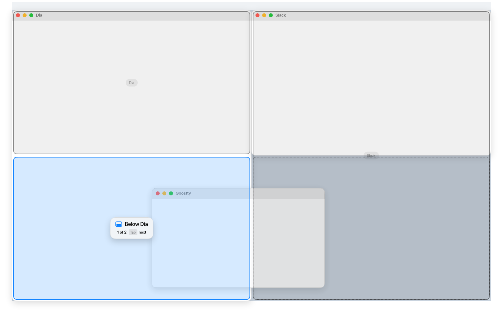

# nanopress

A tiling window manager for macOS that you drive with the mouse. Drag a window by its title bar, see exactly where it will land, let go.

nanopress is a fork of [AeroSpace](https://github.com/nikitabobko/AeroSpace). It keeps AeroSpace's tiling engine and adds drag and drop on top, so you don't need to learn keyboard shortcuts.



## How it works

Drag any window by its title bar. While you drag, an overlay shows the layout you'll get when you let go:

- **Blue:** where the window lands
- **Outlines:** the windows that move or resize because of the drop
- **Dashed outline:** the slot the window came from
- **Card:** what the drop does, in words

What a drop does depends on where the cursor is over another window:

| Cursor | Result |
| --- | --- |
| Near an edge | Splits that window and puts yours next to it, as many levels deep as you like |
| In the middle | Stacks both windows in one slot. Click the edge that peeks out to switch |
| In the middle, holding ⌥ | Swaps the two windows |
| Against the screen edge | Puts the window along that whole side of the screen |
| On an empty workspace | Moves the window there |

When several drops are possible from one spot, the card shows "1 of 3". Press Tab while still holding the mouse to step through them: next to the window, next to its row or column, along the whole screen.

Dialogs and settings windows stay floating. Resizing a window by its edge never triggers a drop.

## Build and run

You need macOS and Swift 6.

```sh
swift build
.build/debug/AeroSpaceApp
```

Grant Accessibility access when macOS asks. Run the tests with `swift test`.

## Design

The overlay's UI is in [`design/`](./design) as Elyx files: the hover card, the regions, the icons, and a mock desktop that puts them together. Edit them there, then copy the changes into [`DropZoneOverlay.swift`](./Sources/AppBundle/ui/DropZoneOverlay.swift).

## Credits

nanopress is built on [AeroSpace](https://github.com/nikitabobko/AeroSpace) by Nikita Bobko. Its [docs](https://nikitabobko.github.io/AeroSpace/guide) still describe the config file, commands and workspaces, which all work the same here.

MIT licensed. See [LICENSE.txt](./LICENSE.txt) and [legal/](./legal).
